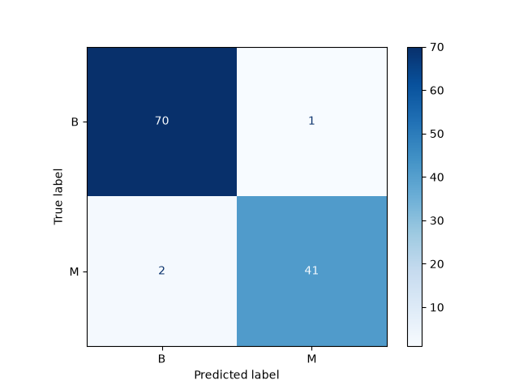

# Breast Cancer Classification Using Logistic Regression

## 1. Context

Early and accurate detection of breast cancer is important for improving patient outcomes. This project explores the use of machine learning to distinguish between benign and malignant breast tumours based on measurements of cell nuclei extracted from digitised fine-needle aspiration (FNA) biopsy images.

The objective was to develop a Logistic Regression model to classify tumours as either benign (non-cancerous) or malignant (cancerous).

The dataset was obtained from [Kaggle](https://www.kaggle.com/datasets/wasiqaliyasir/breast-cancer-dataset) and contains 569 rows and 33 columns.

The analysis was conducted using Jupyter Notebook in Visual Studio Code, with the following Python libraries:

- Pandas
- Matplotlib
- Scikit-learn

## 2. Methodology

- Explored the dataset to understand its structure and identify potential data quality issues.
- Removed the ID column and an empty column.
- Encoded the target variable.
- Separated the features and target variable.
- Split the data into training and testing sets.
- Standardised the features using `StandardScaler`, fitting the scaler on the training data and applying the transformation to the test data.
- Trained a Logistic Regression model.
- Evaluated model performance using accuracy, precision, recall, F1-score and a confusion matrix.

## 3. Results

Confusion matrix:

Classification Report:

| Class         | Precision | Recall | F1-score | Support |
| ------------- | --------- | ------ | -------- | ------- |
| Benign (0)    | 0.97      | 0.99   | 0.98     | 71      |
| Malignant (1) | 0.98      | 0.95   | 0.96     | 43      |
| Accuracy      |           |        | 0.97     | 114     |
| Macro Avg     | 0.97      | 0.97   | 0.97     | 114     |
| Weighted Avg  | 0.97      | 0.97   | 0.97     | 114     |

The Logistic Regression model achieved an accuracy of 97.37%, correctly classifying 111 out of 114 samples. It demonstrated strong performance across both classes, with an F1-score of 0.98 for benign cases and 0.96 for malignant cases.

However, the confusion matrix revealed two false negatives, where malignant cases were incorrectly classified as benign. These misclassifications are particularly important in a medical context, as they could result in missed diagnoses or delayed treatment. Although the model achieved a malignant recall of 95.35%, this highlights the importance of evaluating sensitivity alongside overall accuracy.

## 4. Limitations

- The model was developed and evaluated using a relatively small dataset (569 samples).
- Although the model demonstrated strong classification performance, further evaluation using other classification algorithms could provide insights into how its performance compares with alternative models.
- Hyperparameter tuning could also be explored to investigate whether adjusting model parameters improves classification performance.

## Project Files

- [Jupyter Notebook](breast_cancer_classification.ipynb) – Contains the data exploration, preprocessing, model training and evaluation.
- [Confusion Matrix](images/confusion_matrix.png) – Visual representation of the model's classification results.
